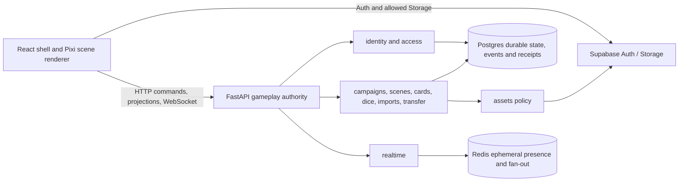

# Architecture and module boundaries

FastAPI is the only gameplay authority. It resolves the actor, applies the room/campaign/object access policy, validates commands, commits durable state and immutable events/receipts in Postgres, and returns actor-filtered projections. Redis holds ephemeral presence, WebSocket tickets, previews, and fan-out. React uses Auth and explicitly allowed Storage flows; gameplay mutations use FastAPI, never direct Supabase Data API writes.

## Backend ownership

- `identity` resolves registered and guest credentials into a participant. `access` is the single role/subject authorization policy; callers receive decisions and filtered projections, not credential details or policy internals. Enforce credential expiry after the final asynchronous membership lookup and at the relevant transaction boundary.
- `campaigns` owns campaigns, rooms, participants, invites, membership and its separate GM security journal. The journal records security observations but is outside gameplay versioning, event cursor, undo, synchronization and campaign export.
- `scenes` owns scene state and command execution. Commands carry identity, expected aggregate version, type and payload; results distinguish accepted, rejected and duplicate receipts. Events remain immutable; undo is compensation of the latest eligible operation. A later local or shared mutation blocks stale restoration.
- `cards` owns card fields, resources, abilities and ownership. `system_packages` supplies versioned schemas and validation. `card_import` parses bounded supported formats into creator-reviewable drafts; explicit confirmation creates gameplay cards. Unknown source fragments and raw bytes stay outside gameplay payloads and follow the import cleanup lifecycle.
- `campaign_transfer` validates portable archives, checksums, identifiers and ZIP safety, then imports using remapped IDs. It is a data portability boundary, not an authority for live state.
- `assets` owns metadata and upload/download authorization while hiding object keys and provider details. `realtime` owns socket sessions, reconnect, presence and fan-out; those transport details do not become domain authority.
- `dice_log` performs server-side rolls and visibility-filtered journal reads. `scene_tools` owns annotations, geometry and compensation helpers; `ability_geometry` computes geometry. The server checks actor access and emits durable gameplay effects.

## Client ownership and cross-cutting rules

- `frontend/src/app` and `routes` own shell, routes and session wiring. `features/*` own feature API adapters and presentation state. Feature calls go through the backend contracts; client preview state does not authorize mutations.
- `frontend/src/renderer` owns viewport, hit testing and Pixi display resources. It renders server projections and local previews; it does not decide gameplay permissions or durable outcomes.
- WebSocket cursors and versions describe gameplay synchronization. Participant status and GM security events are actor-filtered administrative projections. Never expose private events, hidden canaries, or secret-bearing content to a guest projection.
- The emergency offline download is a local, confirmed scene projection for recovery of viewing context. It performs no server mutation and is not a backup, event log, or alternate authority. Clear it on room/identity change or revoke.
- Public contracts and schema changes belong in API/schema tests. Keep transport/provider details behind module boundaries. No external model or AI SDK participates in import, preparation, or gameplay.
